# BÁO CÁO ĐỒ ÁN CUỐI KỲ: MINI DESIGN-PATTERN SHOWCASE APPLICATION

* **Môn học:** Lập trình Hướng đối tượng (OOP) — HK1 2026-2027
* **Giảng viên hướng dẫn (GVHD):** Thầy Huỳnh Xuân Phụng
* **Nhóm sinh viên thực hiện:**
  1. **Hàn Minh Đính** — MSSV: `22110021` (Thành viên A)
  2. **Trần Đức Trung** — MSSV: `22110084` (Thành viên B)
* **Kho lưu trữ GitHub (Repository):** [https://github.com/DinhKore/OOP-Mini-Design-Pattern-Showcase-Application](https://github.com/DinhKore/OOP-Mini-Design-Pattern-Showcase-Application)
* **Ngôn ngữ triển khai:** Java (JDK 17 LTS / JDK 21 LTS)

---

# MỤC LỤC
1. [Phần 1: Phát Biểu Lại Bài Toán & Lựa Chọn Miền Nghiệp Vụ (Domain Restatement)](#phần-1-phát-biểu-lại-bài-toán--lựa-chọn-miền-nghiệp-vụ)
2. [Phần 2: Sơ Đồ Lớp Kiến Trúc UML (UML Class Diagram)](#phần-2-sơ-đồ-lớp-kiến-trúc-uml)
3. [Phần 3: Phân Tích Chuyên Sâu 4 Design Patterns (Problem Before vs Solution After)](#phần-3-phân-tích-chuyên-sâu-4-design-patterns)
   - [3.1. Creational Pattern: GoF Factory Method & Registry](#31-creational-pattern-gof-factory-method--registry)
   - [3.2. Structural Pattern: Decorator & Decorator Chaining](#32-structural-pattern-decorator--decorator-chaining)
   - [3.3. Behavioral Pattern 1: Strategy Pattern](#33-behavioral-pattern-1-strategy-pattern)
   - [3.4. Behavioral Pattern 2: Observer Pattern](#34-behavioral-pattern-2-observer-pattern)
4. [Phần 4: Mục Tự Giải Trình Các Nguyên Lý OOP & Thiết Kế (Self-Explanation Section)](#phần-4-mục-tự-giải-trình-các-nguyên-lý-oop--thiết-kế)
   - [4.1. Encapsulation (Tính Đóng Gói)](#41-encapsulation-tính-đóng-gói)
   - [4.2. Abstraction (Tính Trừu Tượng)](#42-abstraction-tính-trừu-tượng)
   - [4.3. Polymorphism (Tính Đa Hình)](#43-polymorphism-tính-đa-hình)
   - [4.4. Open/Closed Principle (Nguyên Lý Đóng/Mở - OCP)](#44-openclosed-principle-nguyên-lý-đóngmở---ocp)
   - [4.5. Separation of Concerns (Phân Định Trách Nhiệm - SoC)](#45-separation-of-concerns-phân-định-trách-nhiệm---soc)
5. [Phần 5: Minh Chứng Kiểm Thử Hệ Thống (Test Evidence & Execution Logs)](#phần-5-minh-chứng-kiểm-thử-hệ-thống)
6. [Phần 6: Sổ Tay Chuẩn Bị Vấn Đáp Trực Tiếp (Oral / Live-Defense Preparation)](#phần-6-sổ-tay-chuẩn-bị-vấn-đáp-trực-tiếp)

---

# PHẦN 1: PHÁT BIỂU LẠI BÀI TOÁN & LỰA CHỌN MIỀN NGHIỆP VỤ

### 1.1. Bối cảnh & Yêu cầu đề tài
Đề bài yêu cầu xây dựng một ứng dụng nhỏ gọn, có tính kết dính cao (**Single Cohesive Application**) nhằm thị phạm chuẩn xác ít nhất 4 Design Patterns kinh điển (thuộc 3 nhóm Creational, Structural, Behavioral). Mỗi pattern được lựa chọn phải xuất phát từ một bài toán thiết kế thực tế (**genuinely justified by a real design problem**), tuyệt đối không được gượng ép (not shoehorned in). Hệ thống phải làm nổi bật các nguyên lý OOP cốt lõi, đặc biệt là nguyên lý **Open/Closed (OCP)** và **Separation of Concerns (SoC)**.

### 1.2. Miền nghiệp vụ lựa chọn: Hệ Thống Điều Phối Thông Báo (Notification Dispatcher System)
Nhóm lựa chọn miền nghiệp vụ **Notification Dispatcher System**. Đây là một phân hệ cốt lõi trong hầu hết các hệ sinh thái phần mềm hiện đại, chịu trách nhiệm tiếp nhận, định dạng, tăng cường bảo mật và phân phối thông báo đến người dùng cuối qua nhiều kênh truyền thông khác nhau:
* **Email:** Yêu cầu tiêu đề (subject), định dạng địa chỉ email chuẩn RFC Regex.
* **SMS:** Yêu cầu số điện thoại di động chuẩn (10 chữ số bắt đầu bằng đầu số `0` hoặc mã quốc gia `+84`), giới hạn ký tự.
* **Push Notification:** Yêu cầu mã định danh thiết bị di động (Device Token), tiêu đề thông báo ứng dụng.

### 1.3. Ánh xạ 4 Design Patterns vào 4 bài toán thiết kế thực tế
1. **Khởi tạo đối tượng phức tạp & mở rộng không sửa code cũ $\rightarrow$ GoF Factory Method:** Đóng gói quy trình tiền xử lý, chuẩn hóa dữ liệu đầu vào (normalize phone, email) mà không để lộ logic khởi tạo ra Client.
2. **Mở rộng tính năng động & ngăn chặn bùng nổ lớp con $\rightarrow$ Decorator Pattern:** Cho phép bổ sung các tính năng nâng cao (Mã hóa Base64, Gán mức độ ưu tiên) lồng ghép linh hoạt tại runtime mà không cần tạo hàng chục class con kết hợp.
3. **Lựa chọn thuật toán truyền thông báo $\rightarrow$ Strategy Pattern:** Tách rời cơ chế gửi tin (Gửi đồng bộ tức thì vs Gửi bất đồng bộ qua hàng đợi Queue) khỏi bộ điều phối trung tâm.
4. **Giám sát, lưu vết và thống kê độc lập $\rightarrow$ Observer Pattern:** Tách biệt hoàn toàn logic gửi tin khỏi logic ghi nhật ký (Audit Log) và thu thập số liệu (Metrics Tracker).

---

# PHẦN 2: SƠ ĐỒ LỚP KIẾN TRÚC UML

### 2.1. Biểu đồ Mermaid Class Diagram

```mermaid
classDiagram
    direction TB

    %% ==========================================
    %% PACKAGE: model
    %% ==========================================
    class Notification {
        <<abstract>>
        -String id
        -String recipient
        -String message
        -LocalDateTime createdAt
        #Notification(String recipient, String message)
        #Notification()
        +getId() String
        +getRecipient() String
        +getMessage() String
        +getCreatedAt() LocalDateTime
        +prepareContent()* String
        +validateDelivery()* void
        +getDetails() String
    }

    class EmailNotification {
        -String subject
        +EmailNotification(String recipient, String subject, String message)
        +getSubject() String
        +prepareContent() String
        +validateDelivery() void
    }

    class SMSNotification {
        +SMSNotification(String recipient, String message)
        +prepareContent() String
        +validateDelivery() void
    }

    class PushNotification {
        -String deviceToken
        -String title
        +PushNotification(String deviceToken, String title, String message)
        +getDeviceToken() String
        +getTitle() String
        +prepareContent() String
        +validateDelivery() void
    }

    Notification <|-- EmailNotification : extends
    Notification <|-- SMSNotification : extends
    Notification <|-- PushNotification : extends

    %% ==========================================
    %% PACKAGE: decorator
    %% ==========================================
    class NotificationDecorator {
        <<abstract>>
        #Notification wrappedNotification
        +NotificationDecorator(Notification notification)
        +getId() String
        +getRecipient() String
        +getMessage() String
        +getCreatedAt() LocalDateTime
        +prepareContent() String
        +validateDelivery() void
    }

    class EncryptedDecorator {
        +EncryptedDecorator(Notification notification)
        +prepareContent() String
    }

    class PriorityDecorator {
        -PriorityLevel priority
        +PriorityDecorator(Notification notification, PriorityLevel priority)
        +getPriority() PriorityLevel
        +prepareContent() String
    }

    class PriorityLevel {
        <<enumeration>>
        LOW
        NORMAL
        HIGH
        URGENT
    }

    Notification <|-- NotificationDecorator : extends
    NotificationDecorator o-- Notification : wraps (1..1)
    NotificationDecorator <|-- EncryptedDecorator : extends
    NotificationDecorator <|-- PriorityDecorator : extends
    PriorityDecorator ..> PriorityLevel : uses

    %% ==========================================
    %% PACKAGE: factory
    %% ==========================================
    class NotificationCreator {
        <<abstract>>
        +createNotification(String recipient, String titleOrSubject, String message)* Notification
        +createAndValidate(String recipient, String titleOrSubject, String message) Notification
    }

    class EmailNotificationCreator {
        -String defaultSubject
        +EmailNotificationCreator()
        +EmailNotificationCreator(String defaultSubject)
        +createNotification(String recipient, String titleOrSubject, String message) Notification
    }

    class SMSNotificationCreator {
        +SMSNotificationCreator()
        +createNotification(String recipient, String titleOrSubject, String message) Notification
        -normalizePhoneNumber(String phone) String
    }

    class PushNotificationCreator {
        -String defaultTitle
        +PushNotificationCreator()
        +PushNotificationCreator(String defaultTitle)
        +createNotification(String recipient, String titleOrSubject, String message) Notification
    }

    class NotificationFactoryRegistry {
        -Map~String, NotificationCreator~ registry
        +register(String type, NotificationCreator creator) void
        +create(String type, String recipient, String titleOrSubject, String message) Notification
        +hasType(String type) boolean
        +getRegisteredTypes() Set~String~
    }

    NotificationCreator <|-- EmailNotificationCreator : extends
    NotificationCreator <|-- SMSNotificationCreator : extends
    NotificationCreator <|-- PushNotificationCreator : extends

    EmailNotificationCreator ..> EmailNotification : instantiates
    SMSNotificationCreator ..> SMSNotification : instantiates
    PushNotificationCreator ..> PushNotification : instantiates

    NotificationFactoryRegistry o-- NotificationCreator : manages (0..*)
    NotificationFactoryRegistry ..> Notification : returns

    %% ==========================================
    %% PACKAGE: strategy
    %% ==========================================
    class IDispatchStrategy {
        <<interface>>
        +getName() String
        +dispatch(Notification notification) void
    }

    class SyncDispatchStrategy {
        +getName() String
        +dispatch(Notification notification) void
    }

    class AsyncDispatchStrategy {
        -List~Notification~ queue
        +getName() String
        +dispatch(Notification notification) void
        +getQueue() List~Notification~
        +getQueueSize() int
        +clearQueue() void
    }

    IDispatchStrategy <|.. SyncDispatchStrategy : implements
    IDispatchStrategy <|.. AsyncDispatchStrategy : implements
    AsyncDispatchStrategy o-- Notification : stores queued (0..*)

    %% ==========================================
    %% PACKAGE: observer
    %% ==========================================
    class NotificationObserver {
        <<interface>>
        +onDispatchSuccess(Notification notification, String strategyName) void
        +onDispatchFailure(Notification notification, String reason) void
    }

    class SystemLogger {
        -List~String~ logs
        +onDispatchSuccess(Notification notification, String strategyName) void
        +onDispatchFailure(Notification notification, String reason) void
        +getLogs() List~String~
        +clearLogs() void
    }

    class MetricsTracker {
        -int totalDispatched
        -int totalSuccess
        -int totalFailed
        -Map~String, Integer~ strategyUsage
        +onDispatchSuccess(Notification notification, String strategyName) void
        +onDispatchFailure(Notification notification, String reason) void
        +getTotalDispatched() int
        +getTotalSuccess() int
        +getTotalFailed() int
        +getStrategyUsage() Map~String, Integer~
        +reset() void
    }

    NotificationObserver <|.. SystemLogger : implements
    NotificationObserver <|.. MetricsTracker : implements

    %% ==========================================
    %% PACKAGE: dispatcher
    %% ==========================================
    class NotificationDispatcher {
        -IDispatchStrategy strategy
        -List~NotificationObserver~ observers
        +setStrategy(IDispatchStrategy strategy) void
        +getStrategy() IDispatchStrategy
        +subscribe(NotificationObserver observer) void
        +unsubscribe(NotificationObserver observer) void
        +getObserverCount() int
        +dispatch(Notification notification) void
        -notifySuccess(Notification notification) void
        -notifyFailure(Notification notification, String reason) void
    }

    NotificationDispatcher o-- IDispatchStrategy : strategy (0..1)
    NotificationDispatcher o-- NotificationObserver : observers (0..*)
    NotificationDispatcher ..> Notification : validates and dispatches
```


### 2.2. Bảng phân tích các mối quan hệ cấu trúc (Structural Relationships)
| Quan hệ | Lớp nguồn | Lớp đích | Bản chất quan hệ & Mục đích thiết kế |
| :--- | :--- | :--- | :--- |
| **Kế thừa (`<\|--`)** | `EmailNotification`, `SMSNotification`, `PushNotification` | `Notification` | Thừa hưởng định danh, timestamp, và thực thi các hợp đồng trừu tượng (`prepareContent`, `validateDelivery`). |
| **Kế thừa (`<\|--`)** | `NotificationDecorator` | `Notification` | Đảm bảo decorator là một `Notification` (IS-A) để có thể thay thế trong suốt ở mọi nơi nhận `Notification`. |
| **Kết tập (`o--`)** | `NotificationDecorator` | `Notification` | Giữ tham chiếu đối tượng được bọc (1..1) để ủy thác lời gọi và cho phép ghép chuỗi (Decorator Chaining). |
| **Kế thừa (`<\|--`)** | `EncryptedDecorator`, `PriorityDecorator` | `NotificationDecorator` | Các bộ trang trí cụ thể bổ sung hành vi (mã hóa Base64, thêm nhãn ưu tiên). |
| **Kế thừa (`<\|--`)** | `EmailNotificationCreator`, `SMSNotificationCreator`, `PushNotificationCreator` | `NotificationCreator` | Cài đặt Factory Method `createNotification(...)` để khởi tạo kiểu đối tượng tương ứng. |
| **Phụ thuộc (`..>`)** | Các lớp `Creator` con | Các lớp `Notification` con | Quan hệ `<<instantiates>>`: Creator tạo ra instance cụ thể rồi trả về qua kiểu trừu tượng `Notification`. |
| **Kết tập (`o--`)** | `NotificationFactoryRegistry` | `NotificationCreator` | Registry lưu trữ bản đồ các Creator; hỗ trợ đăng ký mở rộng động tại runtime (OCP). |
| **Cài đặt (`<\|..`)** | `SyncDispatchStrategy`, `AsyncDispatchStrategy` | `IDispatchStrategy` | Hiện thực hóa các giải thuật gửi tin khác nhau (gửi tức thì vs lưu hàng đợi). |
| **Cài đặt (`<\|..`)** | `SystemLogger`, `MetricsTracker` | `NotificationObserver` | Các subscriber độc lập lắng nghe sự kiện thành công/thất bại từ Dispatcher. |
| **Kết tập (`o--`)** | `NotificationDispatcher` | `IDispatchStrategy`, `NotificationObserver` | Nhạc trưởng điều phối; tiêm chiến lược gửi (Strategy) và quản lý danh sách lắng nghe (Observers). |

---

# PHẦN 3: PHÂN TÍCH CHUYÊN SÂU 4 DESIGN PATTERNS
*(So sánh Code Smell Trước Khi Dùng vs Giải Pháp Kiến Trúc Sau Khi Dùng)*

### 3.1. Creational Pattern: GoF Factory Method & Registry

#### Vấn đề trước khi dùng (Code Smell):
* **Tight-Coupling & Primitive Obsession:** Khởi tạo đối tượng bằng lệnh gọi `new` trực tiếp ở khắp nơi trong Client, hoặc dùng một lớp `Simple Factory` với khối lệnh `switch-case` đồ sộ:
```java
// CODE SMELL: Simple Factory vi phạm OCP và dính kết chặt
public class NotificationFactory {
    public static Notification create(String type, String recipient, String msg, String extraData) {
        switch (type.toLowerCase()) {
            case "email": return new EmailNotification(recipient, extraData, msg);
            case "sms": return new SMSNotification(recipient, msg);
            default: throw new IllegalArgumentException("Unsupported type");
        }
    }
}
```
* **Hậu quả:** 
  1. **Vi phạm nghiêm trọng nguyên lý Open/Closed (OCP):** Cứ mỗi khi doanh nghiệp hỗ trợ thêm kênh thông báo mới (như Zalo, Push, Telegram), lập trình viên buộc phải can thiệp sửa đổi trực tiếp vào thân hàm `switch-case` của `NotificationFactory.java`.
  2. **Tham số rác (`extraData`):** Email thì cần `extraData` làm subject, SMS thì bỏ xó (`null`), Push thì cần `deviceToken` và `title`. Tham số trở thành một mớ hỗn độn (Flag Argument / Code Smell).
  3. Khởi tạo đối tượng chỉ là lệnh gọi `new` đơn giản, không đóng gói được logic tiền xử lý dữ liệu.

#### Giải pháp sau khi áp dụng (GoF Factory Method + Registry):
* Tạo abstract class `NotificationCreator` định nghĩa Factory Method:
```java
public abstract class NotificationCreator {
    public abstract Notification createNotification(String recipient, String titleOrSubject, String message);
    
    // Non-trivial template operation: tự động kiểm tra hợp lệ trước khi bàn giao
    public Notification createAndValidate(String recipient, String titleOrSubject, String message) {
        Notification notification = createNotification(recipient, titleOrSubject, message);
        notification.validateDelivery();
        return notification;
    }
}
```
* Các lớp con (`EmailNotificationCreator`, `SMSNotificationCreator`) tự xử lý logic khởi tạo phức tạp riêng:
  * `SMSNotificationCreator` tự động chuẩn hóa số điện thoại: loại bỏ dấu cách, dấu gạch ngang, tự động đổi mã vùng `+84` về đầu số `0`.
  * `EmailNotificationCreator` tự động chuẩn hóa chữ thường và gán tiêu đề mặc định nếu bị bỏ trống.
* Lớp `NotificationFactoryRegistry` quản lý danh mục động:
```java
public class NotificationFactoryRegistry {
    private final Map<String, NotificationCreator> registry = new HashMap<>();
    public void register(String type, NotificationCreator creator) { registry.put(type.toLowerCase(), creator); }
    public Notification create(String type, String to, String title, String msg) { return registry.get(type).createNotification(to, title, msg); }
}
```
* **Kết quả:** Triệt tiêu hoàn toàn `switch-case`. Khi thêm `PushNotification`, chỉ cần tạo `PushNotificationCreator` và gọi `registry.register("push", new PushNotificationCreator())` $\rightarrow$ **Đạt chuẩn OCP 100%**.

---

### 3.2. Structural Pattern: Decorator & Decorator Chaining

#### Vấn đề trước khi dùng (Code Smell):
* **Bùng nổ lớp con (Subclass Explosion):** Giả sử hệ thống có 3 loại thông báo gốc (`Email`, `SMS`, `Push`). Khi phát sinh nhu cầu:
  * Cần thông báo có mức độ ưu tiên (`Priority`)
  * Cần thông báo được mã hóa bảo mật (`Encrypted`)
  * Cần thông báo vừa ưu tiên VỪA mã hóa (`Priority + Encrypted`)
* Nếu dùng kế thừa đơn thuần (Inheritance), số lượng class con sẽ tăng cấp số nhân:
  * `PriorityEmailNotification`, `EncryptedEmailNotification`, `EncryptedPriorityEmailNotification`
  * `PrioritySMSNotification`, `EncryptedSMSNotification`, `EncryptedPrioritySMSNotification`
  * `PriorityPushNotification`, `EncryptedPushNotification`, `EncryptedPriorityPushNotification`
* $\rightarrow$ **Hậu quả:** Xuất hiện tới 9+ class mới chỉ để tổ hợp tính năng. Mã nguồn bị trùng lặp nghiêm trọng, không thể bật/tắt tính năng tại runtime.

#### Giải pháp sau khi áp dụng (Decorator Pattern):
* Tạo lớp trừu tượng `NotificationDecorator` kế thừa `Notification` và bọc một trường `protected final Notification wrappedNotification`.
* Cung cấp constructor rỗng có chủ đích `#Notification()` ở lớp cha để **loại bỏ hoàn toàn Ghost state** (không cấp phát UUID và Timestamp rác khi bọc decorator).
* Tạo 2 Concrete Decorators độc lập:
  * `EncryptedDecorator`: Ghi đè `prepareContent()` để mã hóa nội dung chuỗi sang định dạng Base64 (`[ENCRYPTED: ...]`).
  * `PriorityDecorator`: Ghi đè `prepareContent()` để gắn nhãn mức độ ưu tiên (`[PRIORITY: URGENT]`).
* **Sức mạnh của Decorator Chaining (Lồng ghép tại runtime):**
```java
// Khởi tạo thông báo cơ bản
Notification email = emailCreator.createNotification("dinhkore@gmail.com", "OOP Meeting", "Final review");

// Bọc tầng 1: Gán mức độ ưu tiên URGENT
Notification urgentEmail = new PriorityDecorator(email, PriorityDecorator.PriorityLevel.URGENT);

// Bọc tầng 2: Tiếp tục mã hóa toàn bộ nội dung đã có nhãn ưu tiên
Notification secureUrgentEmail = new EncryptedDecorator(urgentEmail);

System.out.println(secureUrgentEmail.getDetails());
```
* **Kết quả:** Chỉ với 2 class Decorator, hệ thống có thể phối hợp linh hoạt hàng chục biến thể khác nhau ngay tại runtime mà không cần sinh thêm bất kỳ một class con kế thừa nào.

---

### 3.3. Behavioral Pattern 1: Strategy Pattern

#### Vấn đề trước khi dùng (Code Smell):
* **Hardcoded Algorithms & Khối if/else phình to trong Dispatcher:**
```java
// CODE SMELL: Dispatcher tự ôm đồm thuật toán gửi tin
public class NotificationDispatcher {
    public void dispatch(Notification note, String mode) {
        if (mode.equals("SYNC")) {
            System.out.println("Transmitting immediately: " + note.prepareContent());
        } else if (mode.equals("ASYNC")) {
            // Nhét vào hàng đợi nội bộ...
        } else if (mode.equals("RETRY")) {
            // Thử gửi lại 3 lần...
        }
    }
}
```
* **Hậu quả:** 
  1. Vi phạm nguyên lý Single Responsibility (SRP): `NotificationDispatcher` vừa phải điều phối luồng, vừa phải quản lý chi tiết thuật toán của từng chế độ gửi.
  2. Không thể hoán đổi thuật toán linh hoạt tại runtime mà không can thiệp vào mã nguồn của Dispatcher.

#### Giải pháp sau khi áp dụng (Strategy Pattern):
* Định nghĩa giao diện `IDispatchStrategy`:
```java
public interface IDispatchStrategy {
    String getName();
    void dispatch(Notification notification);
}
```
* Tách biệt các giải thuật gửi thành các chiến lược độc lập:
  * `SyncDispatchStrategy`: Truyền tải ngay lập tức trong luồng hiện tại.
  * `AsyncDispatchStrategy`: Đẩy thông báo vào hàng đợi (`queue`) chờ xử lý theo lô; cung cấp danh sách chỉ đọc (`Collections.unmodifiableList`).
* Trong `NotificationDispatcher`:
```java
public void setStrategy(IDispatchStrategy strategy) { this.strategy = strategy; }
public void dispatch(Notification notification) {
    notification.validateDelivery();
    strategy.dispatch(notification); // Ủy thác hoàn toàn cho Strategy
}
```
* **Kết quả:** Dispatcher hoàn toàn không cần biết thông báo được gửi bằng cách nào. Việc thay đổi từ gửi tức thời sang xếp hàng chỉ mất 1 dòng lệnh `dispatcher.setStrategy(new AsyncDispatchStrategy())` tại runtime.

---

### 3.4. Behavioral Pattern 2: Observer Pattern

#### Vấn đề trước khi dùng (Code Smell):
* **Tight-Coupling giữa tác vụ gửi tin và các tác vụ giám sát phụ trợ:**
```java
// CODE SMELL: Hàm gửi tin bị phụ thuộc trực tiếp vào Logger và Hệ thống phân tích
public class NotificationDispatcher {
    private FileLogger logger = new FileLogger();
    private MetricsService metrics = new MetricsService();

    public void dispatch(Notification note) {
        // Gửi tin...
        logger.write("Sent " + note.getId()); // Dính kết chặt với FileLogger
        metrics.incrementSuccess();           // Dính kết chặt với MetricsService
    }
}
```
* **Hậu quả:** 
  1. Vi phạm **Separation of Concerns**: Lớp gửi tin phải gánh thêm trách nhiệm ghi nhật ký và thống kê số liệu.
  2. Bất cứ khi nào muốn đổi cách ghi log (từ file sang console, database) hoặc thêm dịch vụ cảnh báo (Email Admin khi lỗi), lập trình viên phải sửa đổi code của Dispatcher.

#### Giải pháp sau khi áp dụng (Observer Pattern):
* Định nghĩa giao diện người quan sát `NotificationObserver`:
```java
public interface NotificationObserver {
    void onDispatchSuccess(Notification notification, String strategyName);
    void onDispatchFailure(Notification notification, String reason);
}
```
* Xây dựng 2 Subscribers hoàn toàn độc lập:
  * `SystemLogger`: Lắng nghe để ghi vết lịch sử kiểm toán (`SUCCESS | strategy=...` hoặc `FAILED | reason=...`).
  * `MetricsTracker`: Lắng nghe để cập nhật chỉ số đo lường hiệu năng (`totalDispatched`, `totalSuccess`, `totalFailed`, `strategyUsage`).
* Trong `NotificationDispatcher`:
```java
public void subscribe(NotificationObserver observer) { observers.add(observer); }
private void notifySuccess(Notification n) { for (NotificationObserver obs : observers) obs.onDispatchSuccess(n, strategy.getName()); }
private void notifyFailure(Notification n, String r) { for (NotificationObserver obs : observers) obs.onDispatchFailure(n, r); }
```
* **Kết quả:** Thể hiện trọn vẹn mô hình **1 Publisher - Đa Subscribers**. Khi Dispatcher bắn sự kiện, cả `SystemLogger` và `MetricsTracker` cùng tự động cập nhật mà không hề biết đến sự tồn tại của nhau.

---

# PHẦN 4: MỤC TỰ GIẢI TRÌNH CÁC NGUYÊN LÝ OOP & THIẾT KẾ
*(Bắt buộc: Chỉ định đích danh Class/Method cụ thể và giải trình lý do kiến trúc)*

### 4.1. Encapsulation (Tính Đóng Gói)
* **Class & Method cụ thể:**
  1. Lớp [`model.Notification`](file:///d:/University/OOP_Again/OOP-Mini-Design-Pattern-Showcase-Application/src/model/Notification.java):
     * Các trường dữ liệu `id`, `recipient`, `message`, `createdAt` đều được khai báo `private final`.
     * Constructor thực thi cơ chế **Fail-fast Validation**:
       ```java
       if (recipient == null || recipient.trim().isEmpty()) throw new IllegalArgumentException("Recipient cannot be empty.");
       if (message == null || message.trim().isEmpty()) throw new IllegalArgumentException("Message content cannot be empty.");
       ```
     * Trạng thái đối tượng là bất biến (Immutable), không cung cấp setter công khai, chỉ cho phép đọc qua getter.
  2. Lớp [`strategy.AsyncDispatchStrategy`](file:///d:/University/OOP_Again/OOP-Mini-Design-Pattern-Showcase-Application/src/strategy/AsyncDispatchStrategy.java) và [`observer.SystemLogger`](file:///d:/University/OOP_Again/OOP-Mini-Design-Pattern-Showcase-Application/src/observer/SystemLogger.java):
     * Các cấu trúc dữ liệu nội bộ `private final List<Notification> queue` và `private final List<String> logs` được đóng gói kín.
     * Phương thức `getQueue()` và `getLogs()` sử dụng:
       ```java
       return Collections.unmodifiableList(queue);
       return Collections.unmodifiableList(logs);
       ```
* **Lý do áp dụng:** Ngăn chặn tuyệt đối việc các đối tượng bên ngoài can thiệp làm thay đổi cấu trúc hàng đợi hoặc sửa đổi lịch sử nhật ký (Data tampering).

---

### 4.2. Abstraction (Tính Trừu Tượng)
* **Class & Method cụ thể:**
  1. Abstract Class [`model.Notification`](file:///d:/University/OOP_Again/OOP-Mini-Design-Pattern-Showcase-Application/src/model/Notification.java):
     * Khai báo hợp đồng trừu tượng: `public abstract String prepareContent();` và `public abstract void validateDelivery();`.
     * Ẩn đi chi tiết kỹ thuật của từng loại giao tiếp (Email regex hay Phone length) đối với lớp điều phối.
  2. Interface [`strategy.IDispatchStrategy`](file:///d:/University/OOP_Again/OOP-Mini-Design-Pattern-Showcase-Application/src/strategy/IDispatchStrategy.java):
     * Trừu tượng hóa hành vi gửi tin qua phương thức duy nhất: `void dispatch(Notification notification);`.
  3. Interface [`observer.NotificationObserver`](file:///d:/University/OOP_Again/OOP-Mini-Design-Pattern-Showcase-Application/src/observer/NotificationObserver.java):
     * Trừu tượng hóa cơ chế phản hồi sự kiện qua `onDispatchSuccess(...)` và `onDispatchFailure(...)`.
* **Lý do áp dụng:** Cho phép bộ điều phối `NotificationDispatcher` chỉ làm việc với các khái niệm trừu tượng cấp cao (Contracts/Interfaces), hoàn toàn độc lập với chi tiết cài đặt của từng giao thức gửi hay từng công cụ lưu log.

---

### 4.3. Polymorphism (Tính Đa Hình)
* **Class & Method cụ thể:**
  1. Phương thức [`validateDelivery()`](file:///d:/University/OOP_Again/OOP-Mini-Design-Pattern-Showcase-Application/src/model/Notification.java#L58):
     * Ở `EmailNotification`: Thực thi kiểm tra định dạng email bằng biểu thức chính quy Regex: `^[^@\s]+@[^@\s]+\.[^@\s]+$`.
     * Ở `SMSNotification`: Thực thi kiểm tra số điện thoại di động Việt Nam (10 số, bắt đầu bằng số 0): `^0\d{9}$`.
     * Ở `PushNotification`: Thực thi kiểm tra device token hợp lệ: `^[A-Za-z0-9_-]{8,}$`.
     * Ở `NotificationDecorator`: Ủy quyền đa hình tiếp tục sang `wrappedNotification.validateDelivery()`.
  2. Lời gọi đa hình tại [`NotificationDispatcher.dispatch()`](file:///d:/University/OOP_Again/OOP-Mini-Design-Pattern-Showcase-Application/src/dispatcher/NotificationDispatcher.java#L58-L62):
     ```java
     notification.validateDelivery(); // Gọi đa hình theo loại đối tượng thực tế tại runtime
     strategy.dispatch(notification); // Gọi đa hình theo chiến lược gửi đang được tiêm vào
     ```
* **Lý do áp dụng:** Dispatcher không cần bất kỳ một câu lệnh kiểm tra kiểu `instanceof` hay `if/else` nào. Tại runtime, phương thức thích hợp của từng kênh thông báo sẽ tự động được triệu gọi.

---

### 4.4. Open/Closed Principle (Nguyên Lý Đóng/Mở - OCP)
* **Class & Method cụ thể:**
  * Lớp [`factory.NotificationFactoryRegistry`](file:///d:/University/OOP_Again/OOP-Mini-Design-Pattern-Showcase-Application/src/factory/NotificationFactoryRegistry.java) và [`factory.NotificationCreator`](file:///d:/University/OOP_Again/OOP-Mini-Design-Pattern-Showcase-Application/src/factory/NotificationCreator.java).
* **Minh chứng cụ thể (Concrete Proof):**
  * Khi yêu cầu nghiệp vụ phát sinh: Cần hỗ trợ thêm loại thông báo **Push Notification**.
  * **Hành động:** 
    1. Tạo mới class `PushNotification.java` kế thừa `Notification`.
    2. Tạo mới class `PushNotificationCreator.java` kế thừa `NotificationCreator`.
    3. Đăng ký vào hệ thống: `registry.register("push", new PushNotificationCreator());`.
  * **Khẳng định OCP:** Toàn bộ các class hiện hữu gồm `Notification.java`, `EmailNotification.java`, `SMSNotification.java`, `NotificationDecorator.java`, `NotificationDispatcher.java`, `IDispatchStrategy.java` **đều được giữ nguyên vẹn 100%, không bị sửa đổi bất kỳ một dòng code nào**.

---

### 4.5. Separation of Concerns (Phân Định Trách Nhiệm - SoC)
* **Phân định rõ ràng qua 6 Package chuyên biệt (Không có God Class):**
  1. `model/`: Chịu trách nhiệm duy nhất là chứa dữ liệu thông báo và tự kiểm tra tính toàn vẹn của dữ liệu đó (`validateDelivery`).
  2. `factory/`: Chịu trách nhiệm duy nhất là tạo lập và chuẩn hóa dữ liệu đầu vào khi khởi tạo đối tượng.
  3. `decorator/`: Chịu trách nhiệm duy nhất là bổ sung tính năng định dạng/mã hóa động cho nội dung.
  4. `strategy/`: Chịu trách nhiệm duy nhất là định nghĩa cơ chế truyền tải thông báo (đồng bộ hoặc hàng đợi).
  5. `observer/`: Chịu trách nhiệm duy nhất là lắng nghe sự kiện để ghi log và thống kê số liệu.
  6. `dispatcher/`: Đóng vai trò nhạc trưởng kết nối các bên, không tự định dạng chuỗi, không tự quyết định cách gửi và không tự ghi log.

---

# PHẦN 5: MINH CHỨNG KIỂM THỬ HỆ THỐNG
*(Toàn bộ 4 kịch bản được tích hợp tự động trong [`src/Main.java`](file:///d:/University/OOP_Again/OOP-Mini-Design-Pattern-Showcase-Application/src/Main.java) và kiểm chứng qua assertions)*

### 5.1. Ma trận ca kiểm thử (Test Case Matrix)

| Test ID | Kịch bản kiểm thử | Dữ liệu đầu vào (Input) | Kết quả mong đợi (Expected) | Kết quả thực tế (Actual) | Trạng thái |
| :---: | :--- | :--- | :--- | :--- | :---: |
| **TC-01** | **Happy Path End-to-End Pipeline** | Khởi tạo Email qua Factory $\rightarrow$ bọc `PriorityDecorator` (URGENT) $\rightarrow$ bọc `EncryptedDecorator` $\rightarrow$ gửi qua `SyncDispatchStrategy`. | Tin nhắn được mã hóa Base64 lồng với nhãn ưu tiên; Logger ghi `SUCCESS \| strategy=Sync`; Metrics ghi nhận `Success=1, Failed=0`. | Trùng khớp hoàn toàn với mong đợi; các assertion pass. | **PASS** |
| **TC-02A** | **Validation: Email sai định dạng** | Địa chỉ recipient: `"invalid-email-address"` (thiếu ký tự `@` và tên miền). | `validateDelivery()` ném ngoại lệ `IllegalArgumentException`; Logger ghi `FAILED \| reason=Invalid email address...`; Metrics ghi nhận `Failed=1`. | Ngoại lệ được bắt chính xác; Logger và Metrics ghi nhận lỗi. | **PASS** |
| **TC-02B** | **Validation: SĐT SMS sai độ dài** | Số điện thoại recipient: `"12345"` (không đủ 10 chữ số). | `validateDelivery()` ném ngoại lệ; Logger ghi `FAILED \| reason=Invalid phone number...`; Metrics ghi nhận `Failed=2`. | Ngoại lệ được bắt chính xác; Logger và Metrics ghi nhận lỗi. | **PASS** |
| **TC-02C** | **Validation: Thiếu Dispatch Strategy** | Tạo Dispatcher nhưng không gọi `setStrategy()`, sau đó gọi `dispatch(...)`. | Dispatcher chặn gửi an toàn, không làm văng app; Logger ghi `FAILED \| reason=No dispatch strategy is set.`. | Bắt lỗi an toàn; hệ thống duy trì tính ổn định. | **PASS** |
| **TC-03** | **Polymorphism & Strategy Swap** | Đổi từ `SyncDispatchStrategy` sang `AsyncDispatchStrategy` tại runtime và gửi SMS (`+84 987 654 321`). | SĐT tự chuẩn hóa thành `0987654321`; SMS được đẩy vào `queue`; Logger ghi `strategy=Async`; `queue.size() == 1`. | Hàng đợi tăng lên 1; số điện thoại được chuẩn hóa đúng; assertion pass. | **PASS** |
| **TC-04** | **Minh chứng nguyên lý OCP** | Đăng ký `PushNotification` qua `PushNotificationCreator` vào Registry $\rightarrow$ bọc `PriorityDecorator` $\rightarrow$ gửi qua Dispatcher. | Kênh Push vận hành trơn tru qua toàn bộ pipeline hiện có; Metrics ghi nhận thành công; không sửa code cũ. | Tin nhắn Push gửi thành công; OCP được xác thực. | **PASS** |

### 5.2. Nhật ký thực thi Console thực tế (Execution Console Log)
```text
======================================================================
     MINI DESIGN-PATTERN SHOWCASE: NOTIFICATION DISPATCHER SYSTEM     
     Members: Han Minh Dinh (22110021) & Tran Duc Trung (22110084)    
======================================================================

----------------------------------------------------------------------
>>> SCENARIO 1: Happy Path End-to-End Pipeline
----------------------------------------------------------------------
[Preview Decorated Notification Details]
[ID: 1b811469-a299-42f6-9fa7-e1e9fa018e1b] 2026-11-06 14:51:10 | To: dinhkore@gmail.com
Content: [ENCRYPTED: W1BSSU9SSVRZOiBVUkdFTlRdCltFbWFpbCAtIFN1YmplY3Q6IE9PUCBGaW5hbCBQcm9qZWN0XQpQbGVhc2UgcmV2aWV3IHRoZSBEZXNpZ24gUGF0dGVybnMgaW1wbGVtZW50YXRpb24gYmVmb3JlIG9yYWwgZGVmZW5zZS4=]
----------------------------------------------------------------------
[Sync Dispatch] Sent immediately to dinhkore@gmail.com -> [ENCRYPTED: W1BSSU9SSVRZOiBVUkdFTlRdCltFbWFpbCAtIFN1YmplY3Q6IE9PUCBGaW5hbCBQcm9qZWN0XQpQbGVhc2UgcmV2aWV3IHRoZSBEZXNpZ24gUGF0dGVybnMgaW1wbGVtZW50YXRpb24gYmVmb3JlIG9yYWwgZGVmZW5zZS4=]
[SystemLogger] SUCCESS | strategy=Sync | id=1b811469-a299-42f6-9fa7-e1e9fa018e1b | to=dinhkore@gmail.com
[MetricsTracker] Updated -> Dispatched: 1 | Success: 1 | Failed: 0
[OK] Scenario 1 (Happy Path E2E) completed with all assertions passed.

----------------------------------------------------------------------
>>> SCENARIO 2: Validation & Error Handling (Rejecting Invalid Input)
----------------------------------------------------------------------
[SystemLogger] FAILED | id=dfe617a7-e38e-4bec-ac62-0cc1563f2482 | to=invalid-email-address | reason=Invalid email address: invalid-email-address
[MetricsTracker] Updated -> Dispatched: 1 | Success: 0 | Failed: 1
[SystemLogger] FAILED | id=cf172fb8-5e8a-45c6-b577-3b286cca837c | to=12345 | reason=Invalid phone number: 12345
[MetricsTracker] Updated -> Dispatched: 2 | Success: 0 | Failed: 2
[SystemLogger] FAILED | id=363dafd9-606f-44fd-acbb-8e2f7c17800f | to=valid@gmail.com | reason=No dispatch strategy is set.
[OK] Scenario 2 (Validation & Error Handling) completed with all assertions passed.

----------------------------------------------------------------------
>>> SCENARIO 3: Polymorphism & Runtime Strategy Swap
----------------------------------------------------------------------
-> Step 3.1: Using SyncDispatchStrategy (Immediate transmission):
[Sync Dispatch] Sent immediately to 0912345678 -> [SMS] (Length: 33 chars) Message: Your verification code is 889900.
[SystemLogger] SUCCESS | strategy=Sync | id=a2a2764e-698b-4738-9b48-d0ed2dd0ec7c | to=0912345678

-> Step 3.2: Swapping to AsyncDispatchStrategy (Queue-based transmission):
[Async Dispatch] Queued notification [ID: 70a97963-a116-4ed9-a9cd-d574e102a3de] for 0987654321 (Queue depth: 1)
[SystemLogger] SUCCESS | strategy=Async | id=70a97963-a116-4ed9-a9cd-d574e102a3de | to=0987654321
[OK] Scenario 3 (Polymorphism & Strategy Swap) completed with all assertions passed.

----------------------------------------------------------------------
>>> SCENARIO 4: Open/Closed Principle (OCP Proof - Adding PushNotification)
----------------------------------------------------------------------
[Sync Dispatch] Sent immediately to device_token_abc12345 -> [PRIORITY: HIGH] | [Push - Title: Server Maintenance] | Device: device_token_abc12345 | Payload: System will undergo scheduled maintenance at midnight.
[SystemLogger] SUCCESS | strategy=Sync | id=1d24ccb0-83ec-46ce-9592-0da28fa63f67 | to=device_token_abc12345
[MetricsTracker] Updated -> Dispatched: 1 | Success: 1 | Failed: 0
[OCP VERIFIED] Added PushNotification & PushNotificationCreator with ZERO edits to existing classes.
[OK] Scenario 4 completed with all assertions passed.

>>> ALL DEMO SCENARIOS & ASSERTIONS PASSED SUCCESSFULLY (100%) <<<
```

---

# PHẦN 6: SỔ TAY CHUẨN BỊ VẤN ĐÁP TRỰC TIẾP (ORAL / LIVE-DEFENSE)
*(Bộ câu hỏi trọng tâm GVHD Huỳnh Xuân Phụng thường chất vấn và câu trả lời chuẩn)*

### ❓ Câu 1: *"Tại sao trong `NotificationDecorator`, em vừa cho kế thừa `<|--` vừa cho kết tập `o--` tới `Notification`? Có bị thừa không?"*
* **Trả lời:** Dạ thưa Thầy, đây là bản chất kinh điển của Decorator Pattern:
  1. Kế thừa (IS-A) để Decorator có cùng kiểu dữ liệu với `Notification`, giúp nó có thể thay thế trong suốt ở bất kỳ hàm nào nhận `Notification`.
  2. Kết tập (HAS-A) để Decorator giữ tham chiếu đến đối tượng được bọc (`wrappedNotification`), từ đó ủy thác lời gọi và cho phép bọc lồng nhau nhiều tầng (Chaining) ngay tại runtime mà không gây bùng nổ class con ạ.

### ❓ Câu 2: *"Tại sao em không dùng một Simple Factory với `switch-case` cho gọn mà phải tạo ra nhiều lớp `Creator` kế thừa `NotificationCreator`?"*
* **Trả lời:** Dạ thưa Thầy, dùng `switch-case` (Simple Factory) là một anti-pattern vi phạm trực tiếp nguyên lý **Open/Closed (OCP)**. Mỗi khi thêm kênh mới (như Push), ta buộc phải mở file Factory cũ ra để sửa `case`. Bằng cách áp dụng **GoF Factory Method** kết hợp với `NotificationFactoryRegistry`, khi thêm kênh mới nhóm chỉ cần tạo một class Creator mới và đăng ký vào Registry, hoàn toàn không sửa đổi bất kỳ class nào cũ ạ.

### ❓ Câu 3: *"Tại sao quan hệ giữa Dispatcher và Strategy/Observer là Aggregation (`o--`) mà không phải Composition (`*--`)?"*
* **Trả lời:** Dạ thưa Thầy, vì hệ thống áp dụng kỹ thuật **Dependency Injection**. Strategy và Observers được khởi tạo độc lập bên ngoài và truyền vào Dispatcher qua các hàm `setStrategy()` và `subscribe()`. Vòng đời của chúng không phụ thuộc vào Dispatcher; khi đối tượng Dispatcher bị thu hồi bộ nhớ, các Observer (chứa danh sách log và metrics thống kê) vẫn tồn tại để phục vụ mục đích khác ạ.

### ❓ Câu 4: *"Trong AsyncDispatchStrategy, tại sao nhóm không dùng Thread hay ExecutorService mà lại dùng Queue trong bộ nhớ?"*
* **Trả lời:** Dạ thưa Thầy, mục tiêu chính của bài toán là thị phạm chuẩn mực **Strategy Pattern** và tính tất định khi kiểm thử. Việc mô phỏng hàng đợi giúp thể hiện rõ sự khác biệt về mặt hành vi thuật toán (Sync xử lý tức thì, Async xếp hàng chờ batch), đồng thời giúp việc assert kiểm tra `queue.size()` và call stack lúc bảo vệ đồ án diễn ra minh bạch, không bị ảnh hưởng bởi race condition hay đa luồng bất định ạ.
