# Biểu Đồ UML Class Diagram — Hệ Thống Notification Dispatcher

Tài liệu này cung cấp thiết kế chi tiết toàn bộ kiến trúc hướng đối tượng của hệ thống **Notification Dispatcher**, thể hiện rõ nét 4 Design Patterns (Factory Method, Decorator, Strategy, Observer) và các mối quan hệ cấu trúc giữa các lớp (Inheritance, Realization, Aggregation, Dependency).

---

## 1. Biểu Đồ Mermaid Class Diagram (Xem trực tiếp trên Markdown / GitHub / VS Code)

```mermaid
classDiagram
    direction TB

    %% ==========================================
    %% PACKAGE: model
    %% ==========================================
    class Notification {
        <<abstract>>
        -String id
        -String recipient
        -String message
        -LocalDateTime createdAt
        #Notification(String recipient, String message)
        #Notification()
        +getId() String
        +getRecipient() String
        +getMessage() String
        +getCreatedAt() LocalDateTime
        +prepareContent()* String
        +validateDelivery()* void
        +getDetails() String
    }

    class EmailNotification {
        -String subject
        +EmailNotification(String recipient, String subject, String message)
        +getSubject() String
        +prepareContent() String
        +validateDelivery() void
    }

    class SMSNotification {
        +SMSNotification(String recipient, String message)
        +prepareContent() String
        +validateDelivery() void
    }

    class PushNotification {
        -String deviceToken
        -String title
        +PushNotification(String deviceToken, String title, String message)
        +getDeviceToken() String
        +getTitle() String
        +prepareContent() String
        +validateDelivery() void
    }

    Notification <|-- EmailNotification : extends
    Notification <|-- SMSNotification : extends
    Notification <|-- PushNotification : extends

    %% ==========================================
    %% PACKAGE: decorator
    %% ==========================================
    class NotificationDecorator {
        <<abstract>>
        #Notification wrappedNotification
        +NotificationDecorator(Notification notification)
        +getId() String
        +getRecipient() String
        +getMessage() String
        +getCreatedAt() LocalDateTime
        +prepareContent() String
        +validateDelivery() void
    }

    class EncryptedDecorator {
        +EncryptedDecorator(Notification notification)
        +prepareContent() String
    }

    class PriorityDecorator {
        -PriorityLevel priority
        +PriorityDecorator(Notification notification, PriorityLevel priority)
        +getPriority() PriorityLevel
        +prepareContent() String
    }

    class PriorityLevel {
        <<enumeration>>
        LOW
        NORMAL
        HIGH
        URGENT
    }

    Notification <|-- NotificationDecorator : extends
    NotificationDecorator o-- Notification : wraps (1..1)
    NotificationDecorator <|-- EncryptedDecorator : extends
    NotificationDecorator <|-- PriorityDecorator : extends
    PriorityDecorator ..> PriorityLevel : uses

    %% ==========================================
    %% PACKAGE: factory
    %% ==========================================
    class NotificationCreator {
        <<abstract>>
        +createNotification(String recipient, String titleOrSubject, String message)* Notification
        +createAndValidate(String recipient, String titleOrSubject, String message) Notification
    }

    class EmailNotificationCreator {
        -String defaultSubject
        +EmailNotificationCreator()
        +EmailNotificationCreator(String defaultSubject)
        +createNotification(String recipient, String titleOrSubject, String message) Notification
    }

    class SMSNotificationCreator {
        +SMSNotificationCreator()
        +createNotification(String recipient, String titleOrSubject, String message) Notification
        -normalizePhoneNumber(String phone) String
    }

    class PushNotificationCreator {
        -String defaultTitle
        +PushNotificationCreator()
        +PushNotificationCreator(String defaultTitle)
        +createNotification(String recipient, String titleOrSubject, String message) Notification
    }

    class NotificationFactoryRegistry {
        -Map~String, NotificationCreator~ registry
        +register(String type, NotificationCreator creator) void
        +create(String type, String recipient, String titleOrSubject, String message) Notification
        +hasType(String type) boolean
        +getRegisteredTypes() Set~String~
    }

    NotificationCreator <|-- EmailNotificationCreator : extends
    NotificationCreator <|-- SMSNotificationCreator : extends
    NotificationCreator <|-- PushNotificationCreator : extends

    EmailNotificationCreator ..> EmailNotification : instantiates
    SMSNotificationCreator ..> SMSNotification : instantiates
    PushNotificationCreator ..> PushNotification : instantiates

    NotificationFactoryRegistry o-- NotificationCreator : manages (0..*)
    NotificationFactoryRegistry ..> Notification : returns

    %% ==========================================
    %% PACKAGE: strategy
    %% ==========================================
    class IDispatchStrategy {
        <<interface>>
        +getName() String
        +dispatch(Notification notification) void
    }

    class SyncDispatchStrategy {
        +getName() String
        +dispatch(Notification notification) void
    }

    class AsyncDispatchStrategy {
        -List~Notification~ queue
        +getName() String
        +dispatch(Notification notification) void
        +getQueue() List~Notification~
        +getQueueSize() int
        +clearQueue() void
    }

    IDispatchStrategy <|.. SyncDispatchStrategy : implements
    IDispatchStrategy <|.. AsyncDispatchStrategy : implements
    AsyncDispatchStrategy o-- Notification : stores queued (0..*)

    %% ==========================================
    %% PACKAGE: observer
    %% ==========================================
    class NotificationObserver {
        <<interface>>
        +onDispatchSuccess(Notification notification, String strategyName) void
        +onDispatchFailure(Notification notification, String reason) void
    }

    class SystemLogger {
        -List~String~ logs
        +onDispatchSuccess(Notification notification, String strategyName) void
        +onDispatchFailure(Notification notification, String reason) void
        +getLogs() List~String~
        +clearLogs() void
    }

    class MetricsTracker {
        -int totalDispatched
        -int totalSuccess
        -int totalFailed
        -Map~String, Integer~ strategyUsage
        +onDispatchSuccess(Notification notification, String strategyName) void
        +onDispatchFailure(Notification notification, String reason) void
        +getTotalDispatched() int
        +getTotalSuccess() int
        +getTotalFailed() int
        +getStrategyUsage() Map~String, Integer~
        +reset() void
    }

    NotificationObserver <|.. SystemLogger : implements
    NotificationObserver <|.. MetricsTracker : implements

    %% ==========================================
    %% PACKAGE: dispatcher
    %% ==========================================
    class NotificationDispatcher {
        -IDispatchStrategy strategy
        -List~NotificationObserver~ observers
        +setStrategy(IDispatchStrategy strategy) void
        +getStrategy() IDispatchStrategy
        +subscribe(NotificationObserver observer) void
        +unsubscribe(NotificationObserver observer) void
        +getObserverCount() int
        +dispatch(Notification notification) void
        -notifySuccess(Notification notification) void
        -notifyFailure(Notification notification, String reason) void
    }

    NotificationDispatcher o-- IDispatchStrategy : strategy (0..1)
    NotificationDispatcher o-- NotificationObserver : observers (0..*)
    NotificationDispatcher ..> Notification : validates and dispatches
```

---

## 2. Mã Nguồn PlantUML (Dành cho việc render ảnh chất lượng cao hoặc chèn vào Slide/Word báo cáo)

```plantuml
@startuml
skinparam classAttributeIconSize 0
skinparam packageStyle rectangle
skinparam handwritten false
skinparam linetype ortho

package "model" {
    abstract class Notification {
        - id: String
        - recipient: String
        - message: String
        - createdAt: LocalDateTime
        # Notification(recipient: String, message: String)
        # Notification()
        + getId(): String
        + getRecipient(): String
        + getMessage(): String
        + getCreatedAt(): LocalDateTime
        + {abstract} prepareContent(): String
        + {abstract} validateDelivery(): void
        + getDetails(): String
    }

    class EmailNotification {
        - subject: String
        + EmailNotification(recipient: String, subject: String, message: String)
        + getSubject(): String
        + prepareContent(): String
        + validateDelivery(): void
    }

    class SMSNotification {
        + SMSNotification(recipient: String, message: String)
        + prepareContent(): String
        + validateDelivery(): void
    }

    class PushNotification {
        - deviceToken: String
        - title: String
        + PushNotification(deviceToken: String, title: String, message: String)
        + getDeviceToken(): String
        + getTitle(): String
        + prepareContent(): String
        + validateDelivery(): void
    }

    Notification <|-- EmailNotification
    Notification <|-- SMSNotification
    Notification <|-- PushNotification
}

package "decorator" {
    abstract class NotificationDecorator {
        # wrappedNotification: Notification
        + NotificationDecorator(notification: Notification)
        + getId(): String
        + getRecipient(): String
        + getMessage(): String
        + getCreatedAt(): LocalDateTime
        + prepareContent(): String
        + validateDelivery(): void
    }

    class EncryptedDecorator {
        + EncryptedDecorator(notification: Notification)
        + prepareContent(): String
    }

    class PriorityDecorator {
        - priority: PriorityLevel
        + PriorityDecorator(notification: Notification, priority: PriorityLevel)
        + getPriority(): PriorityLevel
        + prepareContent(): String
    }

    enum PriorityLevel {
        LOW
        NORMAL
        HIGH
        URGENT
    }

    Notification <|-- NotificationDecorator
    NotificationDecorator o-- Notification : wraps
    NotificationDecorator <|-- EncryptedDecorator
    NotificationDecorator <|-- PriorityDecorator
    PriorityDecorator ..> PriorityLevel
}

package "factory" {
    abstract class NotificationCreator {
        + {abstract} createNotification(recipient: String, titleOrSubject: String, message: String): Notification
        + createAndValidate(recipient: String, titleOrSubject: String, message: String): Notification
    }

    class EmailNotificationCreator {
        - defaultSubject: String
        + EmailNotificationCreator()
        + EmailNotificationCreator(defaultSubject: String)
        + createNotification(recipient: String, titleOrSubject: String, message: String): Notification
    }

    class SMSNotificationCreator {
        + SMSNotificationCreator()
        + createNotification(recipient: String, titleOrSubject: String, message: String): Notification
        - normalizePhoneNumber(phone: String): String
    }

    class PushNotificationCreator {
        - defaultTitle: String
        + PushNotificationCreator()
        + PushNotificationCreator(defaultTitle: String)
        + createNotification(recipient: String, titleOrSubject: String, message: String): Notification
    }

    class NotificationFactoryRegistry {
        - registry: Map<String, NotificationCreator>
        + register(type: String, creator: NotificationCreator): void
        + create(type: String, recipient: String, titleOrSubject: String, message: String): Notification
        + hasType(type: String): boolean
        + getRegisteredTypes(): Set<String>
    }

    NotificationCreator <|-- EmailNotificationCreator
    NotificationCreator <|-- SMSNotificationCreator
    NotificationCreator <|-- PushNotificationCreator

    EmailNotificationCreator ..> EmailNotification : creates
    SMSNotificationCreator ..> SMSNotification : creates
    PushNotificationCreator ..> PushNotification : creates

    NotificationFactoryRegistry o-- NotificationCreator : manages
    NotificationFactoryRegistry ..> Notification : produces
}

package "strategy" {
    interface IDispatchStrategy {
        + getName(): String
        + dispatch(notification: Notification): void
    }

    class SyncDispatchStrategy {
        + getName(): String
        + dispatch(notification: Notification): void
    }

    class AsyncDispatchStrategy {
        - queue: List<Notification>
        + getName(): String
        + dispatch(notification: Notification): void
        + getQueue(): List<Notification>
        + getQueueSize(): int
        + clearQueue(): void
    }

    IDispatchStrategy <|.. SyncDispatchStrategy
    IDispatchStrategy <|.. AsyncDispatchStrategy
    AsyncDispatchStrategy o-- Notification
}

package "observer" {
    interface NotificationObserver {
        + onDispatchSuccess(notification: Notification, strategyName: String): void
        + onDispatchFailure(notification: Notification, reason: String): void
    }

    class SystemLogger {
        - logs: List<String>
        + onDispatchSuccess(notification: Notification, strategyName: String): void
        + onDispatchFailure(notification: Notification, reason: String): void
        + getLogs(): List<String>
        + clearLogs(): void
    }

    class MetricsTracker {
        - totalDispatched: int
        - totalSuccess: int
        - totalFailed: int
        - strategyUsage: Map<String, Integer>
        + onDispatchSuccess(notification: Notification, strategyName: String): void
        + onDispatchFailure(notification: Notification, reason: String): void
        + getTotalDispatched(): int
        + getTotalSuccess(): int
        + getTotalFailed(): int
        + getStrategyUsage(): Map<String, Integer>
        + reset(): void
    }

    NotificationObserver <|.. SystemLogger
    NotificationObserver <|.. MetricsTracker
}

package "dispatcher" {
    class NotificationDispatcher {
        - strategy: IDispatchStrategy
        - observers: List<NotificationObserver>
        + setStrategy(strategy: IDispatchStrategy): void
        + getStrategy(): IDispatchStrategy
        + subscribe(observer: NotificationObserver): void
        + unsubscribe(observer: NotificationObserver): void
        + getObserverCount(): int
        + dispatch(notification: Notification): void
        - notifySuccess(notification: Notification): void
        - notifyFailure(notification: Notification, reason: String): void
    }

    NotificationDispatcher o-- IDispatchStrategy : strategy
    NotificationDispatcher o-- NotificationObserver : observers
    NotificationDispatcher ..> Notification : dispatches
}

@enduml
```

---

## 3. Bảng Phân Tích Mối Quan Hệ Giữa Các Thành Phần

| Thành phần nguồn | Quan hệ | Thành phần đích | Giải thích ý nghĩa kiến trúc |
| :--- | :---: | :--- | :--- |
| `EmailNotification`, `SMSNotification`, `PushNotification` | **Kế thừa (`<\|--`)** | `Notification` | Thừa hưởng các trường chung (`id`, `recipient`, `message`) và hiện thực hóa các phương thức đa hình `prepareContent()`, `validateDelivery()`. |
| `NotificationDecorator` | **Kế thừa (`<\|--`)** | `Notification` | Decorator là một `Notification`, cho phép bọc thay thế trong suốt ở mọi nơi nhận `Notification`. |
| `NotificationDecorator` | **Kết tập (`o--`)** | `Notification` | Chứa tham chiếu `wrappedNotification` (1..1) để ủy thác lời gọi và cho phép ghép chuỗi (Chaining). |
| `EncryptedDecorator`, `PriorityDecorator` | **Kế thừa (`<\|--`)** | `NotificationDecorator` | Các bộ trang trí cụ thể bổ sung hành vi (mã hóa chuỗi, thêm nhãn ưu tiên). |
| `NotificationCreator` | **Kế thừa (`<\|--`)** | `EmailNotificationCreator`, `SMSNotificationCreator`, `PushNotificationCreator` | Đóng gói logic khởi tạo từng kênh cụ thể (chuẩn hóa số điện thoại, gán tiêu đề mặc định). |
| `NotificationFactoryRegistry` | **Kết tập (`o--`)** | `NotificationCreator` | Lưu trữ danh mục các Creator; mở rộng thêm kênh mới qua `register()` tại runtime (OCP). |
| `SyncDispatchStrategy`, `AsyncDispatchStrategy` | **Cài đặt (`<\|..`)** | `IDispatchStrategy` | Hiện thực hóa các giải thuật gửi tin khác nhau (gửi tức thì vs lưu hàng đợi). |
| `SystemLogger`, `MetricsTracker` | **Cài đặt (`<\|..`)** | `NotificationObserver` | Các subscriber lắng nghe sự kiện độc lập để ghi log và thống kê số liệu (Separation of Concerns). |
| `NotificationDispatcher` | **Kết tập (`o--`)** | `IDispatchStrategy`, `NotificationObserver` | Nhạc trưởng điều phối; tiêm chiến lược gửi (Strategy) và quản lý danh sách lắng nghe (Observers). |
